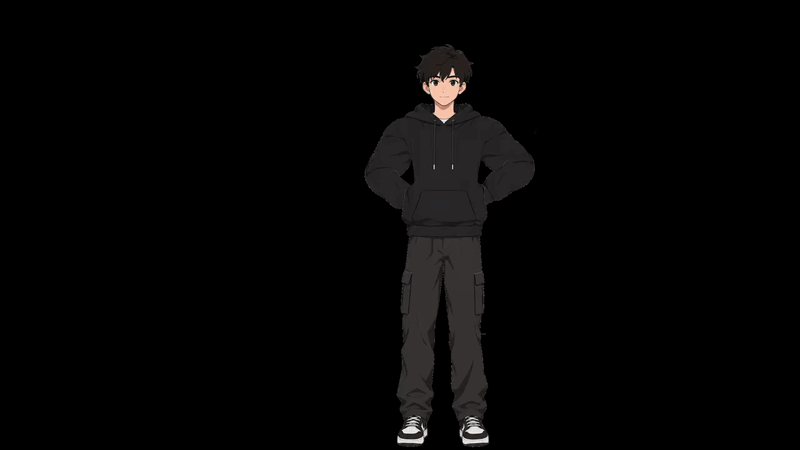

# PuppetMotion 2D 
A high-performance 2D character animation engine written in Rust.

**Turn a single drawing into a game-ready animation.** Open a picture of a character, place its bones, animate it on a timeline, and export a GIF or a sequence of frames.



**Watch Full Demo** - [How to Animate a character in PuppetMotion](https://drive.google.com/file/d/1O8VbxdjmwWYcv2nSqimAuaLceeZXnlxI/view?usp=sharing)

🌐 **Web Version:** [PuppetMotion2D Web](https://adarsh0603.github.io/PuppetMotion2D/)  

💻 **Windows Desktop:** [v0.1.1 Release](https://github.com/Adarsh0603/PuppetMotion2D/releases/tag/v0.1.1) *(Faster performance for high-resolution images)*

<!-- Demo GIF goes here once recorded: a drawing going through Review → Rig → Animate → Export.

-->


Free and open source, written in Rust with egui.

## How it works

<!-- Screenshots go in a first column once recorded: docs/media/review.png, rig.png, animate.png, export.png -->
| Step | What you do |
|---|---|
| **Review** | Open a drawing. The app finds the character and dims the background, so you can check it was cut out cleanly. |
| **Rig** | A skeleton template (front or side view, facing left or right) fits over the character. Drag the joints into place, and each coloured area moves with its bone. You can also build your own skeleton for monsters and animals. |
| **Animate** | Drag hands and feet to pose; the whole limb follows. Press **K** to keep a pose at a frame, move along the timeline, and pose again. The in-betweens are filled in for you. |
| **Export** | Preview the result, then save a looping **GIF** or **PNG frames** for a game engine. |

## Features

- **Automatic cutout:** works with transparent PNGs and with drawings on plain or slightly textured paper, including sketchy outlines with small gaps.
- **Skeletons:** front and side-view person templates, a free-form bone editor, rotation limits, and saving your own templates.
- **Posing:** two-bone IK, so dragging a hand bends the elbow. Children follow their parents, and a draw-order list puts the far arm behind the body.
- **Bending:** the drawing is a mesh that bends smoothly at elbows, knees and other joints, with one softness setting from stiff cut-out to soft and squishy.
- **Weight brush:** paint where each bone pulls the drawing (Add, Remove, Smooth), for example so hair follows the head. A heat map shows the result as you paint.
- **Fill behind parts:** guesses what's hidden behind an arm or the head, so moving them shows more body instead of a hole.
- **Timeline:** keys per bone, Smooth / Linear / Hold easing per key, dragging keys to retime them, frame-rate snapping, and copy / cut / paste of keys, even between projects.
- **Export:** GIF or PNG frames, cropped to the moving character, at any size and frame rate, with a transparent or coloured background.


## Download

Get the latest Windows build from the [Releases](https://github.com/Adarsh0603/PuppetMotion2D/releases) page. It's a single `PuppetMotion2D.exe` with nothing to install.

## Current Development Status

This is an early version that's being actively developed. Currently in development:
- **Auto Rigging and Controlled Animation using AI models:** one click rig generation using AI, Auto generate keyframes for different animation cycles with AI (Walk, Run, Attack etc..) and fine tune them manually.
- **Layered characters:** import each part as its own image (or a PSD) for clean side-view walk cycles.
- **Onion skinning**, a **motion library** to reuse walks on any character, **sprite sheets**, and **MP4** export.

## Build from source

You need [Rust](https://rustup.rs) (stable).

```
git clone https://github.com/Adarsh0603/PuppetMotion2D.git
cd PuppetMotion2D
cargo run --release -p puppetmotion
```

The app is built as `target/release/PuppetMotion2D.exe`.

Run the tests with `cargo test --workspace`.

The code is split into three crates:

| Crate | What it does |
|---|---|
| `core/` | All the logic, with no UI: cutout, skeleton, part split, posing and IK, animation, project files |
| `app/` | The editor window (egui) |
| `export/` | Renders frames on the CPU and writes GIF and PNG |


Ideas and bug reports are welcome in [Issues](https://github.com/Adarsh0603/PuppetMotion2D/issues).

## License

Licensed under either of

- Apache License, Version 2.0 ([LICENSE-APACHE](LICENSE-APACHE))
- MIT license ([LICENSE-MIT](LICENSE-MIT))

at your option.

Unless you explicitly state otherwise, any contribution you intentionally submit for inclusion in this work, as defined in the Apache-2.0 license, shall be dual licensed as above, without any additional terms or conditions.
